# LABORATUVAR 2: IEC 62443 Mini Workshop (Zone & Conduit Modeli)

**Makine / Sistem:** Tırsan Treyler – Hidrolik Dümenlenebilir Low-Bed (SAMİB)  
**Doküman Kodu:** LAB-02-IEC62443-ZC  
**İlgili Standartlar:** IEC 62443-3-2 (Zone & Conduit), IEC 62443-3-3 (Sistem Güvenlik Gereksinimleri)  

---

## 1. Giriş ve IEC 62443 Metodolojisi

IEC 62443-3-2 standardı, endüstriyel otomasyon ve kontrol sistemlerinde (IACS) güvenliği sağlamak için varlıkların risk seviyelerine ve güvenlik gereksinimlerine göre mantıksal/fiziksel **Bölgelere (Zones)** ayrılmasını ve bu bölgeler arasındaki tüm veri akışlarının **Geçiş Kanalları (Conduits)** üzerinden sıkı kontrol altında tutulmasını zorunlu kılar.

Düz (flat) bir otomotiv ağ mimarisinde tek bir telematik açığı tüm makineyi çökertebilirken; Zone & Conduit modeli **Savunma Derinliği (Defense-in-Depth)** sağlayarak siber saldırıların yayılımını engeller.

---

## 2. Görev A: Varlıkların Bölgelere (Zones) Ayrılması

### Treyler Varlık Envanteri
* Dümenleme Kontrol ECU'su
* Hidrolik Oransal Valfler ve Basınç Sensörleri
* Safety PLC / Çift Kanallı Emniyet Valf Bloğu
* Operatör Kontrol Paneli (HMI)
* Kablosuz Uzaktan Kumanda Alıcısı (RF/Bluetooth)
* Telematik / Uzak Teşhis Modülü (4G/LTE Modem)
* Bulut Filo Yönetim Platformu
* Servis Teşhis Portu (OBD / SAE J1939 Soketi)
* Varsayılan Parolalı Bakım Arayüzü (Eski Nesil Web/Telnet Portu)

---

### Güvenlik Bölgeleri (Zones) Sınıflandırması

```mermaid
graph TB
    subgraph Zone4["Zone 4: Dış Bölge (Untrusted / External Zone) [Hedef: SL-T 1]"]
        CLOUD["Bulut Filo Yönetim Platformu"]
        ENGINEER["Uzak Tırsan Servis Mühendisi"]
        TRACTOR["Çekici Araç Ağ Geçidi (ISO 11992)"]
    end

    subgraph Conduit1["Conduit 1: Dış Dünya <-> DMZ Geçişi (IPsec/WireGuard VPN + Karşılıklı TLS)"]
    end

    subgraph Zone3["Zone 3: Bakım / Teşhis & Kablosuz Erişim Bölgesi (DMZ) [Hedef: SL-T 2]"]
        TELEMATICS["Telematik & 4G/LTE Gateway"]
        RC_RX["Kablosuz Kumanda Alıcısı"]
        OBD_PORT["Servis Teşhis Portu (OBD)"]
        AUTH_INT["Kişisel Kimlik Doğrulama Katmanı (Kaldırılan Varsayılan Parola)"]
    end

    subgraph Conduit2["Conduit 2: DMZ <-> Kontrol Geçişi (CAN-Bus Firewall / Gateway Whitelist)"]
    end

    subgraph Zone2["Zone 2: Kontrol / Tahrik Bölgesi (OT Control Zone) [Hedef: SL-T 2]"]
        STEER_ECU["Ana Dümenleme ECU'su"]
        HMI_LOCAL["Yerel Operatör Paneli (HMI)"]
        PROP_VALVES["Hidrolik Oransal Valfler"]
        PRESS_SENS["Sistem Basınç Sensörleri"]
        PUMP_DRIVE["Hidrolik Pompa Sürücüsü"]
    end

    subgraph Conduit3["Conduit 3: Kontrol <-> Safety Geçişi (Tek Yönlü Donanımsal Diyot / Read-Only Durum)"]
    end

    subgraph Zone1["Zone 1: Safety Bölgesi (Safety-Related / SRCS Zone) [Hedef: SL-T 4 / PL e]"]
        SAFETY_PLC["Safety PLC / Emniyet Kontrolörü"]
        ESTOP["Acil Durdurma Butonları (E-Stop)"]
        DEADMAN_SW["Kumanda Dead-Man Emniyet Devresi"]
        SAFETY_VALVES["Çift Kanallı Emniyet Kesme Valfleri"]
        SAFETY_SENS["Bağımsız Açı ve Hız Emniyet Sensörleri"]
    end

    Zone4 --- Conduit1
    Conduit1 --- Zone3
    Zone3 --- Conduit2
    Conduit2 --- Zone2
    Zone2 --- Conduit3
    Conduit3 --- Zone1

    classDef z1 fill:#ffe6e6,stroke:#cc0000,stroke-width:2px;
    classDef z2 fill:#e6f2ff,stroke:#0066cc,stroke-width:2px;
    classDef z3 fill:#fff2cc,stroke:#cc9900,stroke-width:2px;
    classDef z4 fill:#f5f5f5,stroke:#777777,stroke-width:1px;

    class SAFETY_PLC,ESTOP,DEADMAN_SW,SAFETY_VALVES,SAFETY_SENS z1;
    class STEER_ECU,HMI_LOCAL,PROP_VALVES,PRESS_SENS,PUMP_DRIVE z2;
    class TELEMATICS,RC_RX,OBD_PORT,AUTH_INT z3;
    class CLOUD,ENGINEER,TRACTOR z4;
```

#### Zone 1: Safety Bölgesi (Safety Zone - SL-T 4 / Cat 4 / PL e)
* **Varlıklar:** Safety PLC, E-Stop devreleri, Dead-Man alıcı emniyet rölesi, çift kanallı hidrolik emniyet valfleri, donanımsal hız/açı limit sensörleri.
* **Kritiklik:** En yüksek. Bu bölgedeki bir arıza veya manipülasyon doğrudan can kaybına yol açar. Ağ bağlantısı tamamen izoledir; uzaktan hiçbir parametre yazılamaz.

#### Zone 2: Kontrol / Tahrik Bölgesi (OT Control Zone - SL-T 2)
* **Varlıklar:** Ana Dümenleme Kontrol ECU'su, hidrolik pompa sürücüsü, oransal yön valfleri, hidrolik basınç sensörleri ve treyler şasisi üzerindeki yerel HMI paneli.
* **Kritiklik:** Yüksek. Operasyonel dingil yönlendirmesini yönetir. Normal CAN-Bus (J1939) trafiği burada işlenir.

#### Zone 3: Bakım / Teşhis ve Kablosuz Erişim Bölgesi (DMZ - SL-T 2)
* **Varlıklar:** Telematik/uzak teşhis modülü (4G/LTE), kablosuz uzaktan kumanda alıcısı, fiziksel OBD servis soketi ve kimlik doğrulama arayüzü.
* **Kritiklik:** Orta (Saldırı Giriş Kapısı). Dış dünya ile OT ağı arasındaki tampon bölgedir.

#### Zone 4: Dış Bölge (Untrusted / External Zone - SL-T 1)
* **Varlıklar:** Bulut filo takip ve telemetri sunucuları, harici çekici aracın CAN arayüzü ve internetteki servis teknisyenleri.
* **Kritiklik:** Güvenilmeyen (Untrusted) ortam.

---

### Kritik Güvenlik Analizi: Açık Telematik Modülü Nerede Kalmalı?

> **Soru:** Açık uzak bakım / telematik modülü hangi bölgeye düşüyor ve orada KALABİLİR Mİ? Neden?

* **Bulunduğu Bölge:** **Zone 3 (DMZ / Bakım Bölgesi).**
* **Doğrudan Kontrol veya Safety Bölgesinde KALAMAZ!**  
  **Neden:**  
  1. Hücresel şebeke (4G/LTE) üzerinden internete açık bir donanım, her zaman siber saldırıların ilk hedefidir (geniş saldırı yüzeyi).
  2. Eğer telematik modülü doğrudan Zone 2 (Kontrol) veya Zone 1 (Safety) ağında yer alırsa; modül üzerinde bulunabilecek bir RCE (Uzaktan Kod Yürütme) veya kimlik doğrulama açığı, saldırganın hiçbir engelle karşılaşmadan CAN-Bus'a sahte dümenleme açısı göndermesine veya hidrolik emniyet valflerini açmasına izin verir.
  3. Modül kesinlikle Zone 3 (DMZ) içinde tutulmalı, önünde donanımsal güvenlik duvarı (CAN Firewall/Gateway) bulunmalı ve normal şartlarda **varsayılan kapalı (default-closed)** modda çalışmalıdır.

---

### Geçiş Kanalları (Conduits) ve Güvenlik Kontrolleri

| Geçiş Kanalı | Bağlanan Bölgeler | Fiziksel / Mantıksal Ortam | Zorunlu Güvenlik Kontrolleri |
| :--- | :--- | :--- | :--- |
| **Conduit 1** | Zone 4 (Dış) $\longleftrightarrow$ Zone 3 (DMZ) | Hücresel Şebeke / 4G LTE | • Karşılıklı mTLS veya IPsec/WireGuard VPN şifrelemesi. • Yalnızca Tırsan IP Whitelist izinleri. • Telemetri için tek yönlü (outbound-only) MQTT/HTTPS. • Varsayılan parolaların kaldırılması, merkezi MFA. |
| **Conduit 2** | Zone 3 (DMZ) $\longleftrightarrow$ Zone 2 (Kontrol) | Dahili Otomotiv CAN-Bus / Ethernet | • **CAN-Bus Firewall / Gateway:** Mesaj ID beyaz listesi (Sadece teşhis PGN'lerine izin verilir; hareket halindeyken açı yazma PGN'leri engellenir). • Fiziksel servis portu için donanımsal devre kilidi. • Şifreli ve imzalı firmware güncelleme kontrolü. |
| **Conduit 3** | Zone 2 (Kontrol) $\longleftrightarrow$ Zone 1 (Safety) | Kuru Kontak / Donanımsal Kablolama | • **Tek Yönlü İletişim (Read-Only):** Safety PLC, durumunu ana ECU'ya bildirir; ancak ana ECU veya uzak erişimden Safety PLC'ye hiçbir yazma/konfigürasyon emri GİREMEZ. • Hız ve açı emniyet limitleri harici ağdan izole donanımsal pinlerle yönetilir. |

---

## 3. Görev B: Uzak Erişim Karar Matrisi

Tırsan Low-Bed treylerin uzaktan teşhis, kalibrasyon ve servis süreçlerinde siber tehditleri önlemek amacıyla aşağıdaki karar matrisi benimsenmiştir:

| Karar Başlığı | Seçenekler | Seçimimiz | Teknik ve Operasyonel Gerekçe |
| :--- | :--- | :---: | :--- |
| **Aracı?** | Doğrudan / Jump server | **Jump server (Merkezi Servis Geçidi)** | Treyler üzerindeki telematik modülünün doğrudan internetten erişilebilir IP'si olamaz. Tekil ve denetlenebilir bir DMZ Jump Server (Bastion Host) üzerinden kontrollü oturum açılır. |
| **Tünel?** | Açık / VPN | **VPN (IPsec / WireGuard)** | Hücresel şebeke üzerinden akan tüm teşhis, kalibrasyon ve hata verileri kriptografik olarak şifrelenir; Man-in-the-Middle (MitM) ve paket dinleme/enjeksiyon engellenir. |
| **Kimlik?** | Parola / MFA | **MFA (Çok Faktörlü Doğrulama)** | Teknisyen ve servis mühendisi parolaları sızsa veya brute-force edilse bile, donanımsal token veya mobil onay olmadan treylere bağlantı kurulamaz. |
| **Hesap?** | Paylaşılan / Kişisel | **Kişisel (Bireysel Hesaplar)** | Fabrika çıkışı gelen genel "admin", "service", "root" gibi paylaşılan hesaplar tamamen kapatılır. Her mühendis adına açılmış, RBAC (Rol Tabanlı Erişim) yetkili hesaplar zorunlu kılınır. |
| **Kayıt?** | Yok / Tam oturum kaydı | **Tam oturum kaydı (Session Audit Log)** | Treyler ECU'suna gönderilen her UDS (Unified Diagnostic Services) komutu, değiştirilen her kalibrasyon açısı ve erişim zamanı dijital olarak imzalanıp kaydedilir; inkar edilemezlik ve adli analiz sağlanır. |
| **Zamanlama?** | Sürekli açık / Varsayılan kapalı | **Varsayılan kapalı (Default-Closed)** | Uzak erişim kanalı seyir halinde tamamen kapalıdır. Yalnızca treyler güvenli bir park alanında dururken (el freni çekili + hız=0 donanımsal teyidi ile) ve operatör kabinindeki fiziksel butona basılarak onaylandığında belirli bir süre için açılır. |
