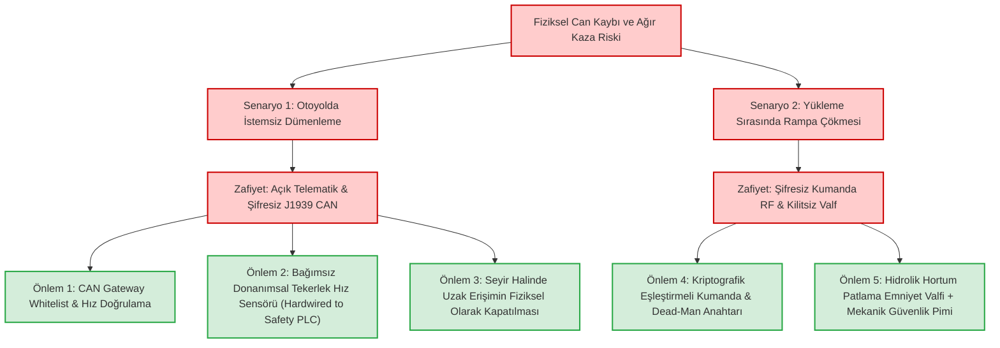

# LABORATUVAR 3: Threat & Risk Analizi + Risk Matrisi

**Makine / Sistem:** Tırsan Treyler – Hidrolik Dümenlenebilir Low-Bed (SAMİB)  
**Doküman Kodu:** LAB-03-RISK-REG  
**Metodoloji:** Otomotiv & Endüstriyel Siber Güvenlik Risk Değerlendirmesi ($L \times S \times E$)  

---

## 1. Risk Değerlendirme Metodolojisi

Risk değerlendirmesinde senaryolar aşağıdaki formül ve ölçeklere göre puanlanmıştır:

$$\text{Risk Skoru} = L \times S \times E$$

* **Olasılık (Likelihood - L):**
  - **1 (Düşük):** Fiziksel erişim, derin uzmanlık ve özel donanım gerektirir.
  - **2 (Orta):** Standart araçlar veya yerel ağ üzerinden belirli koşullarda gerçekleştirilebilir.
  - **3 (Yüksek):** İnternete açık, varsayılan parolalı veya zafiyeti bilinen bileşen; uzaktan kolayca sömürülebilir.
* **Şiddet / Sonuç (Severity - S):**
  - **1 (Düşük):** Maddi/ticari hasar, veri kaybı, operasyonel gecikme (yaralanma yok).
  - **2 (Orta):** Hafif yaralanma, lokal donanım hasarı, geçici iş durması.
  - **3 (Kritik):** **Ölüm, kalıcı sakatlık veya çoklu can kaybına yol açan felaketler (Safety Impact).**
* **Maruziyet (Exposure - E):**
  - **1 (Nadir):** Yalnızca yılda bir fabrika bakımı veya özel test esnasında.
  - **2 (Periyodik):** Yükleme, boşaltma veya şantiye manevraları esnasında.
  - **3 (Sürekli):** Otoyolda seyir halinde, filo operasyonu boyunca 7/24.

> ⚠️ **KRİTİK EMNİYET KURALI (Safety Priority Rule):**  
> Fonksiyonel emniyet ilkeleri gereği; eğer bir senaryonun **Şiddet (Severity) puanı $S = 3$ (Can kaybı / Ağır yaralanma)** ise, toplam risk skoru düşük çıksa dahi o senaryo derhal **EN ÜST ÖNCELİĞE** alınır ve **"S=3 KRİTİK EMNİYET BAYRAĞI"** ile işaretlenir.

---

## 2. Risk Kaydı (Risk Register Tablosu)

| No | Senaryo (Kim $\rightarrow$ Kapı $\rightarrow$ Eylem $\rightarrow$ Zincir $\rightarrow$ Fiziksel Sonuç) | L | S | E | Skor | Öncelik / Statü |
| :---: | :--- | :---: | :---: | :---: | :---: | :---: |
| **1** | **Saldırgan** $\rightarrow$ İnternete açık telematik/uzak bakım modülü + varsayılan servis parolası $\rightarrow$ CAN-Bus hattına sahte hız mesajı ($0\text{ km/s}$) basar ve dümenleme komutu gönderir $\rightarrow$ Yüksek hız kilidi devreden çıkar, otoyolda arka dingiller tam sağa döner $\rightarrow$ **Treyler makaslar/devrilir, sürücü ve çevredekiler hayatını kaybeder.** | 3 | 3 | 3 | **27** | 🚨 **Kritik (En Üst)** |
| **2** | **Yetkisiz Kişi / Kötü Niyetli Aktör** $\rightarrow$ Şifresiz kablosuz uzaktan kumanda frekansı (Replay saldırısı) veya kilitlenmemiş OBD servis portu $\rightarrow$ Yükleme/boşaltma sırasında hidrolik basınç tahliye valfi limitini bozar $\rightarrow$ Deveboynu veya yükleme rampası aniden yere çöker $\rightarrow$ **Altında/yanında çalışan operatör ağır ezilir veya ölür.** | 1 | 3 | 2 | **6** | ⚠️ **Orta $\rightarrow$ ÖNE ALINDI ($S=3$)** |
| **3** | **Siber Saldırgan** $\rightarrow$ Bulut filo yönetim platformu hesabı ele geçirilir $\rightarrow$ Treyler konum geçmişi, yük ağırlık telemetrisi ve bakım takvimleri çalınır / silinir $\rightarrow$ **Operasyonel aksama, hırsızlık riski ve ticari veri kaybı (doğrudan fiziksel yaralanma yok).** | 2 | 1 | 3 | **6** | 🟡 **Orta** |

---

## 3. Derinlemesine Senaryo Analizleri ve Sorular

### Soru 1: En yüksek öncelikli senaryonuz hangisi? Bir cümleyle: neden bu?

* **Cevap:** **Senaryo 1 (Skor: 27 - Kritik).**
* **Gerekçe:** Uzaktan hücresel ağ üzerinden yüksek hız güvenlik kilidinin aşılması; 80 tonluk hareket halindeki bir aracın otoyol hızında kontrolünü anında kaybettirerek doğrudan **toplu can kaybı ve ölümcül zincirleme trafik kazasına** yol açar.

---

### Soru 2: $S=3$ olup skoru düşük kalan senaryonuz var mı? Nasıl görünür kılacaksınız?

* **Cevap:** Evet, **Senaryo 2** ($L=1, S=3, E=2 \rightarrow \text{Skor: } 6$).
* **Görünür Kılma ve Yönetim Stratejisi:**
  1. Klasik matrislerde skoru 6 olan tehditler "orta/düşük risk" olarak değerlendirilip göz ardı edilebilir. Ancak bu senaryoda deveboynunun çökmesi sonucu **insan ezilmesi ve ölümü ($S=3$)** söz konusudur.
  2. Risk kaydında bu senaryoya özel **`[S=3 SAFETY CRITICAL FLAG]`** atanır ve dashboard'larda en üst kategoriye sabitlenir.
  3. **Hafifletme Önlemi:** Sayısal skoruna bakılmaksızın; kablosuz kumandaya **donanımsal Rolling-Code ve AES-128 şifreleme**, hidrolik devreye ise elektriksel sinyallerden bağımsız **mekanik emniyet kilit pimi (mechanical locking pin)** ve pilot kumandalı yük tutma çekvalfleri entegre edilerek risk minimize edilir.

---

## 4. Tehdit Ağacı ve Önleme Matrisi (Mitigation Strategy)

### Risk Azaltma Özeti:
* **Senaryo 1 Kalıntı Risk (Residual Risk):** Önlemler sonrasında $L=1, S=3, E=1 \rightarrow \text{Skor: } 3$ (Kabul edilebilir seviyeye indirildi).
* **Senaryo 2 Kalıntı Risk:** Donanımsal mekanik pim ve şifreli RF ile $L=1, S=1, E=1 \rightarrow \text{Skor: } 1$ (İhmal edilebilir seviye).
* **Senaryo 3 Kalıntı Risk:** Çok faktörlü kimlik doğrulama (MFA) ve TLS 1.3 ile $L=1, S=1, E=2 \rightarrow \text{Skor: } 2$.
