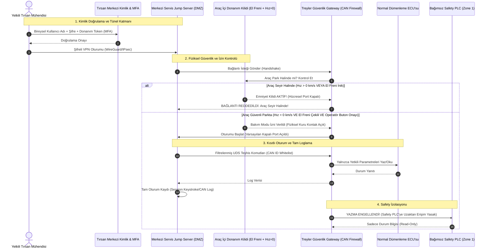

# LABORATUVAR 4: Güvenli Uzak Erişim Mimarisi (Secure Remote Access)

**Makine / Sistem:** Tırsan Treyler – Hidrolik Dümenlenebilir Low-Bed (SAMİB)  
**Doküman Kodu:** LAB-04-REMOTE-ACC  
**İlgili Standartlar:** IEC 62443-3-3, ISO 13849-1, NIST SP 800-207 (Zero Trust)  

---

## 1. Görev A: Mevcut vs. Hedef Mimari Karşılaştırması

Ağır nakliye operasyonlarında sahadaki treylerlerin servis kalibrasyonları ve arıza teşhisleri için uzaktan bağlantı zorunludur. Ancak emniyet kritik bir araçta bu bağlantının denetimsiz olması felakete davetiye çıkarır.

### Mevcut (As-Is) Durum Zafiyet Analizi
* **Açık Kapı:** 4G telematik modülü internete doğrudan bağlıdır ve gelen bağlantılara 7/24 açıktır.
* **Düz Veri Yolu:** Telematik modülü, normal dümenleme ECU'su ve emniyet sensörleri tek bir paylaşımlı SAE J1939 CAN-Bus hattı üzerindedir.
* **Zayıf Kimlik Doğrulama:** Sahadaki servis teknisyenleri fabrika çıkışı ortak/varsayılan parolaları (`admin:admin`, `service123`) kullanmaktadır.
* **Kayıt ve Denetim Yok:** Kimin, hangi saatte, treylerin hangi kalibrasyon parametresini değiştirdiği loglanmamaktadır.

---

### Hedef (To-Be) Güvenli Mimari: Beş Temel İlke

Aşağıdaki şemada "Zero Trust" ve "Savunma Derinliği" ilkeleriyle yeniden tasarlanan mimari yer almaktadır:



### Beş Güvenlik İlkesi Özeti:
1. **Merkezi Jump Server (Bastion Host):** Mühendisler treylere doğrudan bağlanamaz; tüm trafik DMZ'deki denetimli ve izole ara sunucu üzerinden geçer.
2. **Uçtan Uca Şifreli Tünel (VPN) ve MFA:** GSM şebekesi dinlense bile veriler IPsec/WireGuard ile şifrelidir; SMS yerine TOTP/FIDO2 MFA zorunludur.
3. **Kişisel Hesap ve RBAC:** Genel parolalar silinmiştir; her eylem mühendis bazında yetkilendirilir.
4. **Tam Oturum Kaydı (Audit Trail):** Yapılan her kalibrasyon ve parametre değişikliği zaman damgalı olarak adli kayıt altına alınır.
5. **Varsayılan Kapalı ve Donanımsal Yetki (Default-Closed):** Uzak erişim portu seyir halindeyken fiziksel olarak enerjisizdir. Yalnızca treyler tam durduğunda, el freni çekildiğinde ve yerdeki operatör treyler üzerindeki fiziksel bakım anahtarını çevirdiğinde açılır.

---

## 2. Görev B: Functional Safety Köprüsü (Safety-Security Co-Engineering)

### Soru 1: Saldırgan tüm önlemlere rağmen içeri girerse: emniyet fonksiyonu etkilenir mi? Neden?

* **Cevap:** **HAYIR, ETKİLENMEMELİDİR.**
* **Teknik Nedenler ve Mimari İzolasyon:**
  1. **Donanımsal Bağımsızlık:** Safety PLC ve çift kanallı hidrolik emniyet kesme valfleri; telematik modülünden, hücresel modemden ve normal dümenleme ECU'sundan fiziksel olarak ayrılmıştır.
  2. **Doğrudan Hardwired Emniyet Sensörleri:** Tekerlek hız sensörleri ve açı limit sviçleri doğrudan Safety PLC'nin donanımsal güvenli girişlerine (Safety Digital Inputs) kablo ile bağlıdır.
  3. **CAN Mesajlarına Güvenmeme Prensibi:** Saldırgan telematik modülünü ele geçirip CAN-Bus hattına sahte "Araç Hızı = 0 km/s" mesajları bassa dahi, Safety PLC hız bilgisini harici CAN hattından değil, **doğrudan kendine bağlı tekerlek devir sensörünün frekansından** okur.
  4. **Fiziksel Engelleme:** Safety PLC araç hızının >15-20 km/s olduğunu algıladığı anda, ana kontrol ECU'sundan veya uzak bağlantıdan gelen tüm yönlendirme komutlarını bypass ederek hidrolik emniyet valflerinin pilot enerjisini keser ve dingilleri kilitli tutar.

---

### Soru 2: Emniyet Fonksiyonunun Uzak Bakım Yolundan Etkilenmemesi İçin Fonksiyonel Emniyet GEREKSİNİMİ

> ⚠️ **NOT:** Bu bir çözüm önerisi (firewall, şifre vb.) değil; mimariyi bağlayan **resmi emniyet gereksinimidir (Safety Requirement Specification).**

```
[GEREKSİNİM-SRCS-SEC-01]:
"Uzak bakım modülü, telematik hücresel arayüzü ve operasyonel dümenleme kontrolörü (ECU) 
tamamen güvenliği ihlal edilmiş (compromised) veya yetkisiz bir aktörün tam kontrolü altına 
girmiş olsa dahi; 

Güvenlikle İlgili Kumanda Sistemi (SRCS):
1. Araç hızı tanımlanan güvenli eşik değerinin (>15 km/s) üzerinde olduğu sürece 
   arka dingillerin herhangi bir harici/dahili komutla açı almasını DONANIMSAL OLARAK ENGELLEMELİ,
2. Ortaya çıkabilecek herhangi bir tutarsızlık, sinyal kaybı veya sınır aşımı durumunda 
   hidrolik tahriki azami 100 milisaniye içerisinde GÜVENLİ DURUMA (Safe State) geçirmeli,
3. Emniyet parametreleri (hız eşiği, basınç ve açı sınırları) hiçbir uzak veya harici 
   sayısal ağ üzerinden DEĞİŞTİRİLEMEMELİ; bu parametreler yalnızca araç tam durur vaziyetteyken, 
   yerinde fiziksel kilit anahtarı ve kriptografik yerel doğrulama ile güncellenebilmelidir."
```
