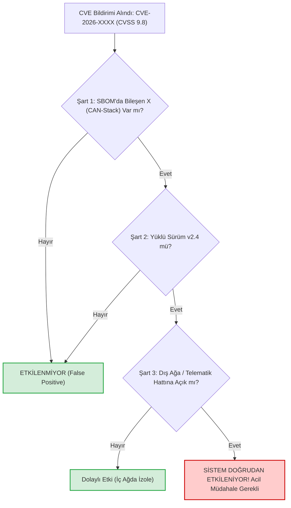

# LABORATUVAR 5: SBOM, Zafiyet (CVE) ve Yama Yönetimi

**Makine / Sistem:** Tırsan Treyler – Hidrolik Dümenlenebilir Low-Bed (SAMİB)  
**Doküman Kodu:** LAB-05-SBOM-PATCH  
**İlgili Standartlar:** UNECE R156 (Yazılım Güncelleme - SUMS), ISO 21434, IEC 62443-4-1 / 4-2  

---

## 1. Verilen Zafiyet Kaydı (Security Advisory)

* **Etkilenen Bileşen:** `LowBed-Telematics-Gateway` / Dahili Açık Kaynak `CAN-Stack` Kütüphanesi (Bileşen X)
* **Tespit Edilen Sürüm:** `v2.4`
* **Zafiyet Kodu:** **CVE-2026-XXXX**
* **CVSS v3.1 Skoru:** **9.8 (Kritik - CVSS:3.1/AV:N/AC:L/PR:N/UI:N/S:U/C:H/I:H/A:H)**
* **Zafiyet Türü:** Uzaktan Kimlik Doğrulamasız Kod Yürütme (RCE) ve Doğrudan CAN Veri Yolu Mesaj Enjeksiyonu
* **Yama Durumu:** Tedarikçi tarafından yayınlanmış resmi yama (`v2.4.1-patch1`) mevcut.

---

## 2. Beş Kritik Güvenlik Kararı ve Analizler

### Soru 1: Bu CVE sizi gerçekten etkiliyor mu? (Üç Şart Analizi)

Bir siber güvenlik zafiyetinin varlığı, sistemin kesin olarak etkilendiği anlamına gelmez. Tırsan SBOM (Software Bill of Materials) envanteri üzerinden aşağıdaki **3 Şart Doğrulaması** gerçekleştirilir:

1. **Varlık Kontrolü:** İlgili CAN-Stack kütüphanesi Tırsan SAMİB treyler telematik ağ geçidinin donanım yazılımında derlenmiş midir? $\rightarrow$ **EVET.**
2. **Sürüm Kontrolü:** Sahadaki aktif treylerlerde koşan yazılım sürümü tam olarak `v2.4` müdür? $\rightarrow$ **EVET.**
3. **Erişilebilirlik Kontrolü (Exploitability):** Bu kütüphane hücresel modem (4G/LTE) veya kablosuz RF portu üzerinden dış paketleri dinlemekte midir? $\rightarrow$ **EVET.**

> **Sonuç:** Üç şart da "EVET" olduğu için Tırsan Low-Bed filosu **doğrudan ve kritik derecede risk altındadır.**

---

### Soru 2: Filoyu / üretimi hemen durdurur musunuz? Neden / neden değil?

* **Karar:** **Filoyu veya fabrikayı aniden durdurmam (HAYIR).**
* **Stratejik ve Operasyonel Gerekçe:**
  - Sahada yüzlerce ağır nakliye treyleri otoyollarda, şantiyelerde veya uluslararası lojistik hatlarındadır. Filoyu derhal trafikten çekmek devasa bir tedarik zinciri krizine ve milyonlarca avroluk cezai yaptırımlara yol açar.
  - **Doğru Strateji (Hızlı İzolasyon):** Treylerleri durdurmak yerine; **merkezi telekom APN/VPN sunucuları üzerinden uzaktan erişim portlarını tek tıkla bloke ederim.** Araçların telematik modüllerine gelen internet trafiği kesildiğinde saldırı vektörü ($AV:N$) anında ortadan kalkar.
  - Araçlar güvenle çalışmaya devam eder; yama ise planlı ilk güvenli park veya servis molasında yüklenir.

---

### Soru 3: Yamayı doğrudan mı uygularsınız, önce test mi? Nerede test?

* **Karar:** **Asla doğrudan sahadaki araçlara yüklenmez; ÖNCE KAPSAMLI TEST EDİLİR.**
* **Test Ortamı ve Süreci:**
  1. **HIL (Hardware-in-the-Loop) Laboratuvarı:** Tırsan Ar-Ge merkezinde gerçek ECU, telematik modülü ve hidrolik simülatörün bağlı olduğu test tezgahında yama uygulanır.
  2. **CAN Mesaj Yük Testi:** Ağ geçidinin saniyede binlerce CAN mesajı altında bellek sızıntısı (memory leak) veya paket düşürme yaşayıp yaşamadığı doğrulanır.
  3. **Fiziksel Prototip Şasi Testi:** Fabrika test pistinde gerçek hidrolik yük ve ağır tonaj altında manevra testleri yapılır.
  4. **Rollback (Geri Dönüş) Planı:** Yama yüklemesi sırasında bağlantı koparsa modülün önceki kararlı sürüme dönebilmesi ($A/B\ Partitioning$) doğrulanmadan sahaya çıkılmaz.

---

### Soru 4: Bu yama bir safety validation etkiliyor mu? Nasıl anlarsınız?

* **Analiz:** **EVET, ETKİLEYEBİLİR.**
* **Risk:** CAN-Stack kütüphanesine yapılan bir güvenlik yaması; kod optimizasyonunu değiştirebilir, mesaj gecikmelerine (latency), jitter'a veya watchdog zamanlayıcılarının kaymasına neden olabilir.
* **Nasıl Anlaşılır ve Ne Yapılır?**
  - **Tedarikçi Sürüm Notları & Kod Karşılaştırması:** Değiştirilen satırlar incelenir.
  - **Bara Yükü ve Gecikme Ölçümü:** Osiloskop ve CAN bus analizörleri ile hız kilitleme mesajının tepki süresinin $<50\text{ ms}$ sınırında kalıp kalmadığı ölçülür.
  - **ISO 13849-2 Doğrulama Testi:** Eğer emniyetle ilgili mesaj döngüleri değişmişse, fonksiyonel emniyet doğrulama süreci (Safety Validation) resmi olarak tekrarlanır.

---

### Soru 5: Yama mümkün değilse compensating control (telafi edici önlem) ne olur?

Eğer üretici yamayı henüz yayınlamamışsa veya sahadaki araç donanımı yetersiz kalıyorsa aşağıdaki telafi edici kontroller derhal devreye alınır:

| Telafi Edici Önlem | Uygulama Katmanı | Koruma Mekanizması |
| :--- | :--- | :--- |
| **CAN TX Hattını Kesme (Salt Okunur Mod)** | Donanım / Gateway | Telematik modülünün CAN-Bus'a mesaj gönderme (TX) pini yazılımsal/donanımsal olarak kapatılır. Modül sadece araç verisini okur (RX), içeriye tek bir bit dahi yazamaz. |
| **Hücresel IP Whitelisting & Özel APN** | Telekom / Ağ | Treyler SIM kartları genel internete kapatılır; yalnızca Tırsan güvenli veri merkezine ait sabit IP'ler ile haberleşecek özel APN'e (Private APN) geçirilir. |
| **OBD Soketine Fiziksel Mühür** | Mekanik / Fiziksel | Treyler üzerindeki servis soketine numaralandırılmış güvenlik mührü ve kilitli kapak takılır; yetkisiz erişim fiziksel olarak engellenir. |
| **CAN Bus Anomali Tespit (IDS)** | Yazılım | Ağda tanımlı olmayan bir hız mesajı veya yüksek frekanslı dümenleme komutu görüldüğünde sesli alarm veren yerel IDS kuralı işletilir. |
